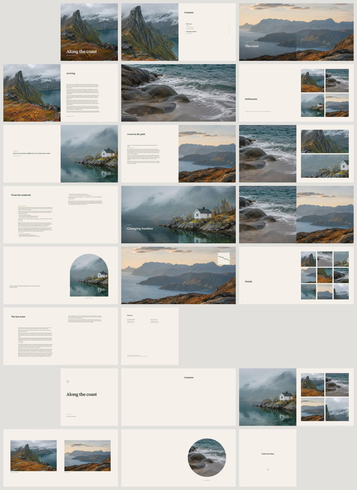

<h1><picture>
  <source media="(prefers-color-scheme: dark)" srcset="resources/brand/logo/imageflow-horizontal-dark.svg">
  
</picture></h1>

ImageFlow is a macOS app for designing photobooks and wall calendars from photos, Markdown and editable templates. Arrange spreads, crop photos and edit text on the page, check the book as you work, and export proof or print-ready PDFs.

[Documentation](https://wirhabenzeit.github.io/imageflow/) · [Getting started](https://wirhabenzeit.github.io/imageflow/guide/getting-started) · [Writing templates](https://wirhabenzeit.github.io/imageflow/templates/)



Sample artwork: [Photobook light](docs/images/photobook-starter-light.jpg) · [Photobook dark](docs/images/photobook-starter-dark.jpg) · [Calendar overview](docs/images/calendar-starter.jpg) · [January page](docs/images/calendar-month.png)

ImageFlow includes Photobook, Wall calendar and Typography templates. Each `.imageflow` book keeps its own layouts, settings and content, with support for linked source files. Templates are TypeScript and React code; local AI agents can inspect, preview, check and edit books through MCP.

## Install

Download the Apple silicon `.dmg` from [GitHub Releases](https://github.com/wirhabenzeit/imageflow/releases), open it and drag **ImageFlow** to **Applications**. Until the first release is published, build from source using the commands below.

See [Getting started](https://wirhabenzeit.github.io/imageflow/guide/getting-started) for your first book and [updates](https://wirhabenzeit.github.io/imageflow/guide/getting-started#updates) for automatic updates and Stable/Beta channels. Open only books and templates you trust: templates run code. Replace the sample photos before ordering a print; they are upscaled placeholders.

## Develop

Use Node.js 22.20+ or 24.12+ on macOS.

```sh
npm ci
npm run dev
```

This opens a temporary copy of the Photobook starter with hot reloading. Edits to that copy are disposable. Use `npm run dev -- --last` to reopen your last book, or `npm run dev -- --starter calendar` for the Wall calendar starter.

```sh
npm run build          # build and type-check the app, templates and API examples
npm run test:unit      # unit tests
npm run test:desktop   # build, unit tests and full desktop suite
npm run package:mac    # package an ad-hoc-signed Mac app
```

Desktop tests require Poppler (`brew install poppler`). See [Setup](docs/development/setup.md), [Testing and CI](docs/development/testing.md), and [Releasing](docs/releasing.md) for packaging, signing and release checks.

## Documentation

The [documentation site](https://wirhabenzeit.github.io/imageflow/) is built from [`docs/`](docs):

- [User guide](docs/guide/getting-started.md): books, sources, editing, the workspace and PDF export.
- [Template authoring](docs/templates/index.md): layouts, parameters, editors and the template API.
- [Agent connection and tools](docs/mcp.md): local MCP setup, book commands, checks and previews.
- [Development](docs/development/setup.md): setup, tests, branding and releases.
- [Documentation maintenance](docs/development/docs-site.md): sources, generation, link checks and publishing.

Edit template API topics in `docs/template-api/`, then run `npm run generate:docs` to update the combined reference and [agent skill](skills/imageflow-templates/SKILL.md). Design proposals and early implementation plans are kept as history in the site's Development section.
