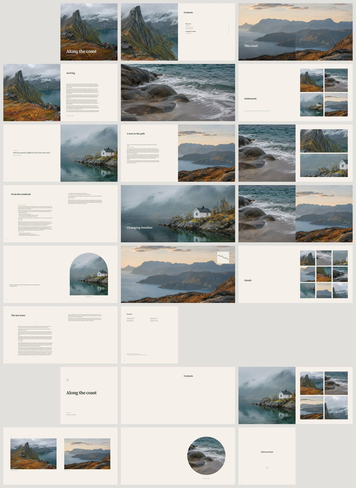

# Getting started

ImageFlow is a Mac app for designing photobooks and wall calendars with photos, Markdown text and editable templates. It checks your book as you work and exports proof and print-ready PDFs.

## Requirements and installation

ImageFlow runs on Macs with Apple silicon. Download the `.dmg` from [GitHub Releases](https://github.com/wirhabenzeit/imageflow/releases), open it and drag **ImageFlow** to **Applications**.

Until the first release is published, build ImageFlow from source instead; see [Setup](../development/setup.md).

## Your first book

1. Open ImageFlow and choose **New Book…**.
2. Pick a template, then name and save the book. **Photobook** and **Wall calendar** can include sample content; other templates start with their opening spreads or empty.
3. Import JPEG, PNG or WebP photos with **File → Import…**, or drop them onto the Photos strip. Drag photos onto the spread's photo boxes.
4. Drop a Markdown file onto a text box, or choose **New Text** in the Texts strip.
5. Click the [Book check](checking-and-export.md#book-check) icon in the status bar to review issues.
6. Choose **File → Export PDF…** for a proof, or **File → Export for Print…** for a checked print PDF.

Each book opens in its own window. Closing the last book returns to the start window. **Window → Welcome to ImageFlow** opens it at any time.

::: warning Sample photos
The Photobook sample photos are upscaled placeholders. They pass the resolution check but print soft. Replace them before ordering.
:::

## Built-in templates

**Photobook** is a travel journal in square and landscape formats. Book settings control colours, heading fonts, text size, photo spacing and page numbers. Layouts include title and contents pages, chapters, photo stories, quotes, panoramas, grids, GPX maps and photo credits.

**Wall calendar** offers A3 and A2 landscape formats, with an optional cover and one photo per month. Book settings control the first month, language and colours. Mark dates in **Marked days**, such as `25.12` for every year or `2027-04-16` for once, or import all-day events from an `.ics` file. Click a month's days to mark a date once; Option-click marks it every year. Unsupported calendar repeats mark only their first date and produce a Book check warning.

Templates run code. Only open books and templates you trust.

## Next steps

- [Editing a book](editing.md): spreads, photos, text and settings.
- [Books and sources](books-and-sources.md): document contents and linked files.
- [The workspace](workspace.md): panels, menus and shortcuts.
- [Writing templates](../templates/index.md): create your own layouts.
- [Connecting agents](agents.md): work with an AI agent.
