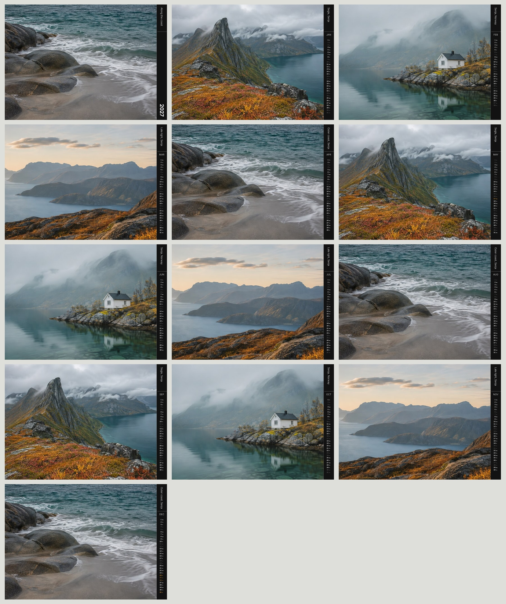

# Template library

**Templates → Manage Templates…** lists the templates available for new books. Select one to see its preview, formats, layouts, bundled packages and network permissions.

- **Import:** choose **Import…**, drop a template folder or `.imageflow-template` file into the window, or open a template file in Finder. Imports with packages or network access require confirmation.
- **Export:** share any entry, including built-in templates, as an `.imageflow-template` file.
- **Remove:** select an imported template and press Delete to move it to the Trash.

The library keeps one entry per template ID. A newer version replaces it; importing an older version asks first. Existing books keep their own template copies.

To share a template edited inside a book, import the book's `template/` folder, then export the library entry.

Templates run code. Only import templates you trust. To create your own, see [Writing templates](../templates/index.md).

## Built-in examples

The Photobook starter includes a complete sample book in [light](https://github.com/wirhabenzeit/imageflow/blob/main/docs/images/photobook-starter-light.jpg) and [dark](https://github.com/wirhabenzeit/imageflow/blob/main/docs/images/photobook-starter-dark.jpg) themes.

The Wall calendar starter includes a cover and twelve monthly pages. [Open the January page](https://github.com/wirhabenzeit/imageflow/blob/main/docs/images/calendar-month.png) to see the month strip in detail.

